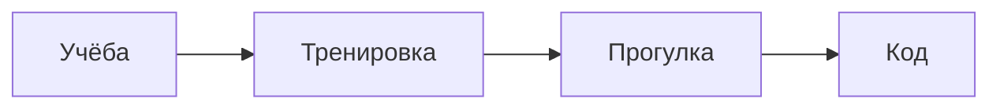

## Привет! 👋

Меня зовут **Соня**. Мне 18 лет и я учусь в ИТМО!

### 🔭 Чем занимаюсь
- Сейчас работаю над: Саморазвитием
- Сейчас изучаю: С и С++

### Спорт
- играю в большой теннис и падл
- до 8 класса занималась балетом
- люблю кататься на лыжах

### 💬 Обо мне
- фамилия: Васильева
- Интересный факт обо мне: Я знаю Английский язык 
- я люблю гулять
- я люблю ходить по улице
- мне не 17 лет
- мне 18!
- я совершеннолетняя


## Таблица

| цвет | ассоциация |
| --- | --- | --- |
| красный | бык |
| зеленый | трава |
| синий | небо |


<!-- Карточка с активностью -->


[Ссылка на GitHub](https://github.com)

## 🧑‍💻 Блок кода

```python
def greet(name):
    return f"Привет, {name}!"

print(greet("мир"))
```
## ✅ Планы

- [x] Создать репозиторий с README
- [x] Добавить таблицу и цитату
- [ ] Выучить китайский язык
- [ ] Создать макс 2.0
      
## 🗺 Схема моего дня



